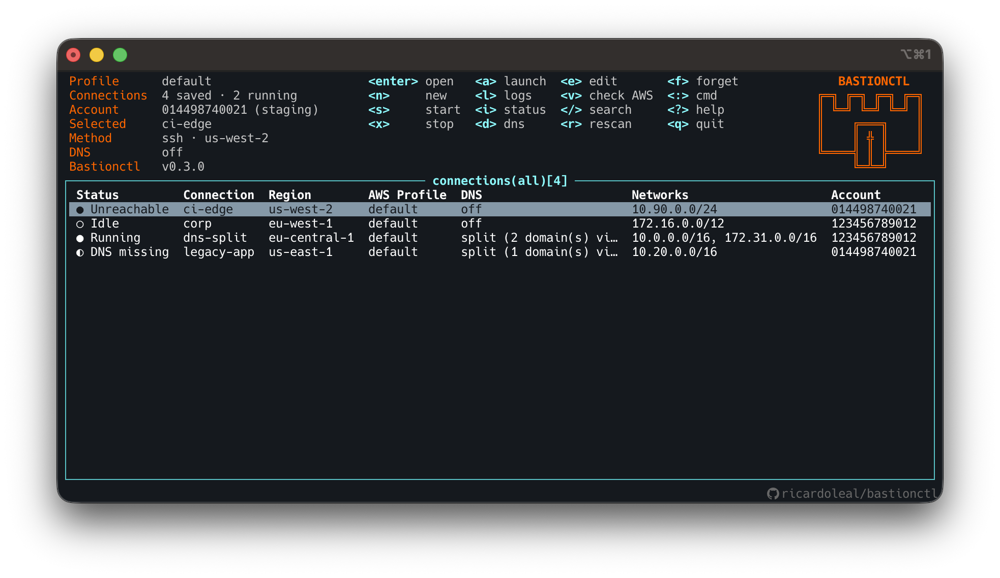

# bastionctl



Find, test, and remember the best EC2 pivot for [sshuttle](https://github.com/sshuttle/sshuttle) into AWS VPCs.
bastionctl discovers reachable instances, saves connections per account, and
prints the tunnel command. It supports private instances through SSM and
optional split DNS; it does not implement tunneling itself.

## Install

Install with Homebrew:

```bash
brew tap ricardoleal/tap
brew install bastionctl
```

**Required:** `sshuttle` is installed automatically as a Homebrew dependency.
For other installation methods, ensure `sshuttle` is available on `PATH`.

For private instances reached through SSM, also install the Session Manager
plugin and configure SSH. See [SSM prerequisites](docs/requirements.md#ssm-prerequisites).

Run `bastionctl` to open the connection browser. Use `bastionctl --demo` to
explore it with simulated data and no AWS calls or file changes.

## Documentation

- [Usage and commands](docs/usage.md)
- [Interactive browser](docs/interactive-browser.md) and [editor](docs/editor.md)
- [Connection architecture](docs/architecture.md)
- [Configuration](docs/configuration.md)
- [Split DNS](docs/split-dns.md)
- [IAM permissions and limitations](docs/requirements.md)
- [Build and development](docs/development.md)
