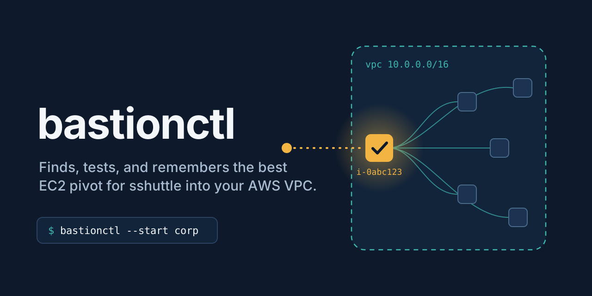
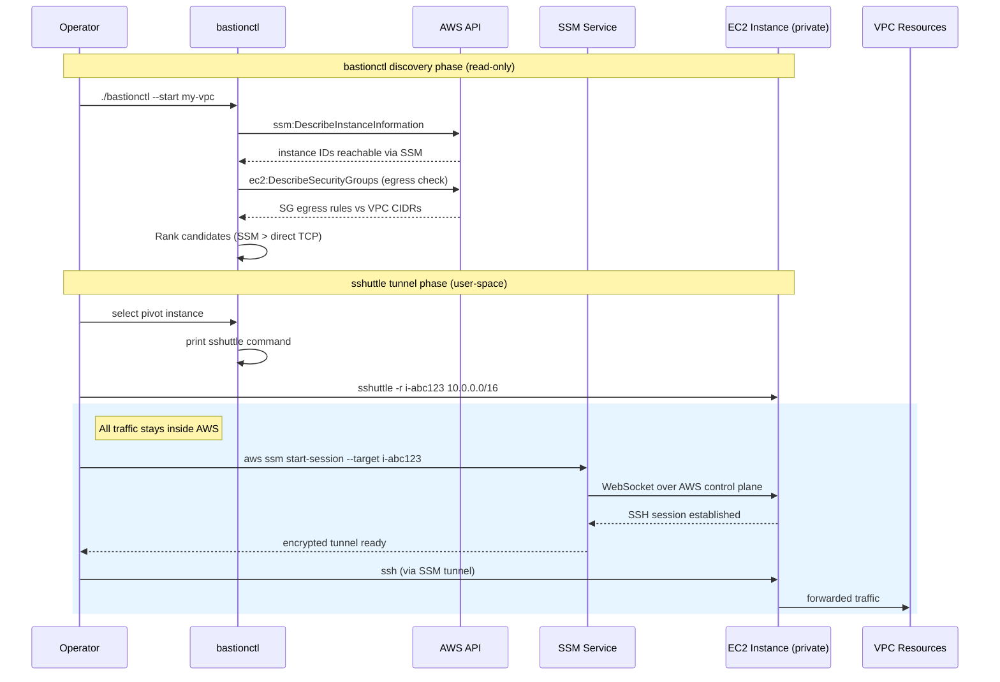
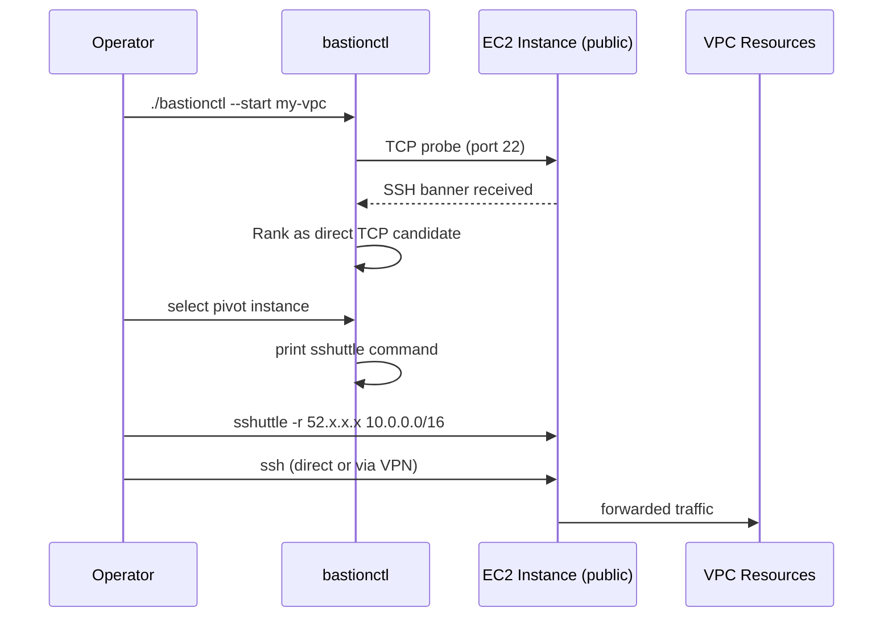
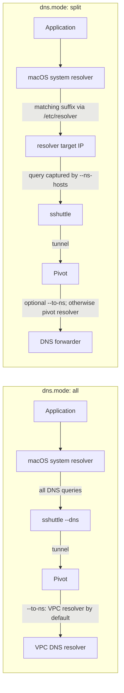

Finds, tests, and remembers the best EC2 instance to use as an `sshuttle`
pivot into an AWS VPC.

## How it works

- Resolves AWS credentials via STS and lists saved connections per account.
- **New connection**: discovers VPCs, lists running instances, and checks
  reachability via SSM (`ssm:DescribeInstanceInformation`) and direct TCP.
- Each candidate's Security Group egress is checked against VPC CIDRs to
  verify it can route traffic — restricted egress candidates rank lower.
- You pick a candidate from an interactive menu, re-verify with a real
  `ssh` attempt, choose SSH user/key, and save as **VPC** or **Dedicated
  network** (custom routes from the instance's subnet route table).
- **Subsequent runs**: re-check the saved target and print, launch, or
  background the tunnel.

bastionctl hands off to your system's `sshuttle` binary — it does **not**
reimplement sshuttle's tunneling. Run the printed command as your normal
user; `sshuttle` elevates its firewall helper when needed. bastionctl
itself never elevates anything except the opt-in split-DNS resolver
configuration (`--manage-dns` / `--dns-setup`, see below), where `sudo`
is used solely for writing `/etc/resolver` files (macOS) or creating a
dummy network link (Linux).

## Connection architecture

### SSM-brokered connection (no public IP required)



**Why this is secure:**

- **No inbound ports open** — the EC2 instance needs no public IP, no SSH
  port in its Security Group. SSM uses the outbound AWS management
  channel (443) that every SSM-managed instance already has.
- **AWS-authenticated only** — `aws ssm start-session` requires valid IAM
  credentials with `ssm:StartSession` permission. No SSH keys are
  exposed over the network.
- **Private network path** — traffic from your machine to the VPC never
  traverses the public internet. The SSM tunnel is end-to-end encrypted
  via the AWS control plane.
- **No credential storage** — bastionctl never stores or transmits SSH
  keys. It relies on your existing `~/.ssh/config` and `ssh-agent`.
- **bastionctl is read-only** — it only calls `Describe*` APIs. The
  actual tunnel is established by `sshuttle` using your system's
  `ssh`, which inherits your SSH config (ProxyCommand for SSM, keys,
  agent).

### Direct TCP connection (public IP / VPN)



## Install

Via [ricardoleal/homebrew-tap](https://github.com/ricardoleal/homebrew-tap):

```bash
brew tap ricardoleal/tap
brew install bastionctl
```

For SSM-brokered targets (no public IP) you also need:

```bash
brew install --cask session-manager-plugin
```

and a `~/.ssh/config` entry:

```
Host i-* mi-*
    ProxyCommand sh -c "aws ssm start-session --target %h --document-name AWS-StartSSHSession --parameters 'portNumber=%p'"
```

See: https://github.com/ricardoleal/bastionctl#prerequisites-for-ssm-brokered-targets

## Build

```bash
make help
make build
make test
make run
make run ARGS="--aws-profile prod"
```

`make run` rebuilds the binary before launching it.

Cross-compile (no CGO, single static binaries):

```bash
GOOS=darwin  GOARCH=arm64 go build -o bin/bastionctl-darwin-arm64  .
GOOS=darwin  GOARCH=amd64 go build -o bin/bastionctl-darwin-amd64  .
GOOS=linux   GOARCH=amd64 go build -o bin/bastionctl-linux-amd64   .
GOOS=linux   GOARCH=arm64 go build -o bin/bastionctl-linux-arm64   .
```

## Usage

```bash
./bastionctl                          # first run: interactive discovery
./bastionctl --aws-profile prod       # use an AWS shared-config profile
./bastionctl --connection corp        # use/create a named connection
./bastionctl --vpc-id vpc-0abc123     # target a specific VPC
./bastionctl --region eu-central-1    # override region
./bastionctl --rescan corp            # refresh a saved connection
./bastionctl --forget corp            # delete one saved connection
./bastionctl --launch                 # run sshuttle in the foreground
./bastionctl --start corp             # start sshuttle in the background
./bastionctl --stop corp              # stop a background tunnel
./bastionctl --status corp            # show tunnel status
./bastionctl --logs                   # follow daemon logs live
./bastionctl --demo                   # k9s-style browser on simulated data
                                      # (no AWS, no writes; see "Demo mode"; hidden)

# Split DNS (see the "Split DNS" section below)
./bastionctl --dns split --dns-domain corp.internal --dns-resolver 10.0.0.2 corp
./bastionctl corp --manage-dns --start   # also auto-manage the OS resolver config
./bastionctl --dns-setup corp         # install the resolver config and exit
./bastionctl --dns-teardown corp      # remove the resolver config and exit
```

### Interactive k9s-style browser

In a terminal, a bare run opens a full-screen connection browser (k9s
style) with a persistent information header and a key-hint footer. Two
levels:

```
 bastionctl · connections · 123456789012 (example)             2 connections · 1 running
──────────────────────────────────────────────────────────────────────────────────
  Status                    Connection   Account       Kind   Method  …  Networks
 >● Running                 dns-split    123456789012  vpc    ssm        10.0.0.0/16
  ○ Idle                    corp         123456789012  vpc    ssh        172.16.0.0/12
──────────────────────────────────────────────────────────────────────────────────
 enter open  n new  s start  x stop  l logs  i status  d dns  r rescan  f forget  : cmd  q quit
```

- **Home (level 0)** lists every cached connection across accounts with a
  colored status dot: `●` green running, `○` gray idle, `●` red stopped
  while its target is unreachable, `◐` yellow running with the split-DNS
  resolver config missing.
- **Connection view (level 1** — `enter`/`s`/… from home) shows the full
  state card (tunnel, target reachability, DNS install state, selected
  routes, the exact sshuttle command) with its own action row; `esc`
  goes back.
- **Single-key actions** fire on the highlighted row directly — no
  arrowing through a menu first.
- **`:` command line** — type commands like `stop corp`, `logs`,
  `dns install dns-split`, `rescan`, `new`, `help`; `tab` completes.
- **Offline mode** — if AWS STS is unreachable, bastionctl still starts
  and lets you browse/manage every cached connection (start/stop/status/
  logs/forget still work through the saved config); network-only actions
  (`new`, `rescan`) report the outage instead of crashing.

All CLI flags keep working unchanged for scripting; non-TTY runs keep
the classic single-shot print behavior. A fresh discovery save drops
you into the connection view of the new connection.

All interactive menus render on a private full-screen view sized to the
terminal: long route, candidate, and DNS lists scroll inside the window
(`↑/↓`, PgUp/PgDn) instead of spilling past the top of the screen.

`--start` uses sshuttle's native daemon mode (may ask for sudo). `--logs`
streams syslog history — on macOS it's system-wide; on Linux it uses
journald or `/var/log/syslog`. `--stop` validates the PID file before
sending SIGTERM.

Connections are stored per account:

```text
~/.config/bastionctl/accounts/<account-id>/<connection>.yaml
```

`$XDG_CONFIG_HOME` and `--config-dir` are supported. Interactive menus use
arrow keys (or `j`/`k`) and Enter; Space toggles a CIDR in the network
selector.

### Demo mode

To see the browser without any AWS access — handy for demos, talks, and
screen recordings — run:

```sh
./bastionctl --demo
```

It opens the same interactive browser against four simulated connections
(covering all four status states) across two fake accounts. Actions (start,
stop, logs, split-DNS install, forget, …) mutate the mock state and print
plausible output, but **nothing touches your config, pid files, or resolver
configs**, and no AWS calls are made. `--demo` is hidden from `--help`.

### Manual configuration

Prefer to skip discovery? Write the connection file by hand at
`~/.config/bastionctl/accounts/<account-id>/<connection>.yaml`
(`account_id` must match the directory, `chmod 600`):

```yaml
# ~/.config/bastionctl/accounts/123456789012/corp.yaml
name: corp
kind: vpc                        # vpc | dedicated
account_id: "123456789012"
region: eu-central-1
vpc_id: vpc-0abc123
vpc_cidrs:
  - 10.0.0.0/16
subnet_id: subnet-0abc123
instance_id: i-0abc123
name_tag: pivot
routes:
  - cidr: 10.0.0.0/16
    source: pivot_vpc
    selected: true
connection_method: ssm            # ssm | direct_ip
target: i-0abc123                # instance ID for ssm, IP address for direct_ip
ssh_port: 22
dns:                              # optional; omit for no DNS handling
  mode: split                     # off | all | split
  resolver:                       # intercept target (--ns-hosts)
    - 10.0.0.2
  domains:                        # suffixes routed to the tunnel resolver
    - corp.internal
    - svc.cluster.local
  # to_ns: 10.0.0.2               # optional --to-ns forward target
  manage_resolver: false          # true = install OS resolver config for you
```

For `direct_ip` targets, point `target` at the IP and set credentials:

```yaml
connection_method: direct_ip
target: 52.10.20.30
ssh_user: ec2-user
ssh_key_path: ~/.ssh/corp.pem
```

For `ssm` targets, leave `ssh_user`/`ssh_key_path` blank to keep using
your `~/.ssh/config` as-is.

## Split DNS

By default the tunnel only routes the selected subnets. To also resolve
*chosen domain suffixes* through the VPC (private Route53 zones,
internal services), use split DNS.

### How it fits together

sshuttle cannot filter DNS by domain. It can only capture whole
resolvers: `--ns-hosts <IP>` intercepts queries **sent to** an IP, and
`--dns` intercepts everything your local system resolvers see. So split
DNS is a two-part trick, with no bundled DNS server:

1. **The OS resolver** sends only the configured suffixes to the VPC
   resolver IP (bastionctl configures this, or prints the commands).
2. **`--ns-hosts`** captures exactly the queries that arrive at that IP
   and tunnels them; everything else keeps using your normal resolvers.

The VPC resolver IP is auto-detected from the VPC's primary IPv4 CIDR
using AWS's "*network base + 2*" convention (`10.0.0.0/16` → `10.0.0.2`).
In `all` mode, bastionctl forwards every captured DNS query to this VPC
resolver by default (`--to-ns`). Set `dns.to_ns` or `--dns-to-ns` to use a
different forwarder. This does not install or change the local OS resolver.

### Modes

| `dns.mode`      | sshuttle flags                  | Meaning                                                                 |
| --------------- | ------------------------------- | ----------------------------------------------------------------------- |
| `off` (default) | *(none)*                        | Historical behavior; subnets only.                                      |
| `all`           | `--dns --to-ns <IP>`            | Resolve **all** DNS through the VPC resolver (or explicit `dns.to_ns`). |
| `split`         | `--ns-hosts <IP>` (+ `--to-ns`) | Only the listed domains go to the VPC resolver.                         |

### DNS routing diagrams



### macOS resolver compatibility

For private domains on macOS, prefer `split` mode when applications use the
system resolver (for example, `ssh`). Full `all` mode asks sshuttle to capture
DNS traffic, but some macOS system-resolver clients may still fail to resolve
private names even when `dig` succeeds. Split mode installs a per-domain
resolver entry so macOS sends those suffixes directly to the VPC resolver.
Check resolution with the application or system API that needs the name, not
only with `dig`.

Settings live in each connection's YAML (`dns:` block, see above);
`--dns`, `--dns-domain`, `--dns-resolver` and `--dns-to-ns` persist
overrides to the saved connection.

### Using it

The resolver part is opt-in — bastionctl never touches system resolver
configuration without being asked:

```bash
# Configure + persist the DNS settings, then print the sshuttle command
# plus the exact resolver setup/teardown commands to copy-paste:
./bastionctl corp --dns split --dns-domain corp.internal --dns-resolver 10.0.0.2

# Let bastionctl install/remove the resolver config for you (asks for sudo):
./bastionctl corp --start --manage-dns

# Or manage it explicitly, without starting a tunnel:
sudo ./bastionctl --dns-setup corp       # install (or re-reconcile)
./bastionctl --dns-teardown corp         # remove what was installed
```

What gets installed per platform:

- **macOS**: one `/etc/resolver/<domain>` file per domain, containing a
  `nameserver <tunnel IP>` directive. Every file is tagged with a
  `# Generated by bastionctl for connection <name>` header plus a
  content hash, so teardown only removes files this connection owns,
  warns about files edited after install, and never touches foreign
  resolver files.
- **Linux (systemd-resolved)**: a dedicated dummy link
  (`bctl-<hash>`), wired with `resolvectl dns`/`resolvectl domain
  <link> '~corp.internal' …` so only those routing suffixes use it.
  bastionctl refuses to reuse an existing link that is not one of its
  own dummy links and checks for `ip`/`resolvectl` up front. Systems
  without systemd-resolved get a `dnsmasq` snippet in the error message.

Runtime state (what was installed, and where) is recorded beside the
connection YAML as `<connection>.dns-state.yaml`; teardown always runs
from that snapshot, never from the current YAML. `--stop`, `--forget`
and an explicit `--dns-teardown` all clean it up; `--status` shows the
DNS line and warns when the config is still installed while the tunnel
is down. `--rescan` reconciles the installed configuration with the new
settings.

During interactive discovery a "DNS handling" menu (Off / All / Split)
prefills the `dns:` block; `--dns*` flags act as presets for a
first-time connection and are then saved.

## IAM Permissions (read-only)

```
ec2:DescribeInstances
ec2:DescribeRegions
ec2:DescribeVpcs
ec2:DescribeSecurityGroups
ec2:DescribeRouteTables
ssm:DescribeInstanceInformation
sts:GetCallerIdentity
```

- `ec2:DescribeRouteTables` — dedicated network discovery; non-fatal if missing.
- `ec2:DescribeRegions` — region picker; falls back to profile region if missing.
- `iam:ListAccountAliases` — optional, shows alias in header.
- `ssm:DescribeInstanceInformation` — separate from `ssm:StartSession`; may need to be added.

## Prerequisites for SSM-brokered targets

- **Session Manager plugin** for the AWS CLI.
- A `~/.ssh/config` entry proxying through it:
  ```
  Host i-* mi-*
      ProxyCommand sh -c "aws ssm start-session --target %h --document-name AWS-StartSSHSession --parameters 'portNumber=%p'"
  ```
  bastionctl uses your existing `ssh` config — it never invokes
  `aws ssm start-session` directly.

## Known Limitations

- No caching/backoff tuning beyond AWS SDK defaults.
- SG-to-SG rule references and managed prefix lists are not resolved in
  the egress check.
- Bulk ranking never shells out to real `ssh`/`aws ssm start-session`;
  the real test runs once on your final selection.
- Dedicated-network discovery reads only the selected instance's subnet
  route table — add external ranges manually.
- Split DNS captures resolver traffic per IP, not per protocol:
  browsers with DoH/DoT (DNS-over-HTTPS/TLS) bypass the OS resolver, and
  single-label unqualified names resolved via `/etc/hosts`-style search
  behavior may not follow the split rules.
- If a split-DNS tunnel daemon dies without `--stop`, the resolver
  config stays installed until `--dns-teardown`/`--stop` runs;
  `--status` warns about this.
- VPC resolver auto-detection is IPv4-only (AWS's "+2" convention); for
  IPv6 resolvers set `--dns-resolver` explicitly.
- Linux split DNS requires systemd-resolved (`ip`, `resolvectl`);
  otherwise bastionctl only prints a dnsmasq snippet.
- `--manage-dns` is a one-way switch for the current invocation: once a
  connection is set to auto-manage, run `--dns-teardown` (and remove
  `manage_resolver` from its YAML) to go back to manual setup.
