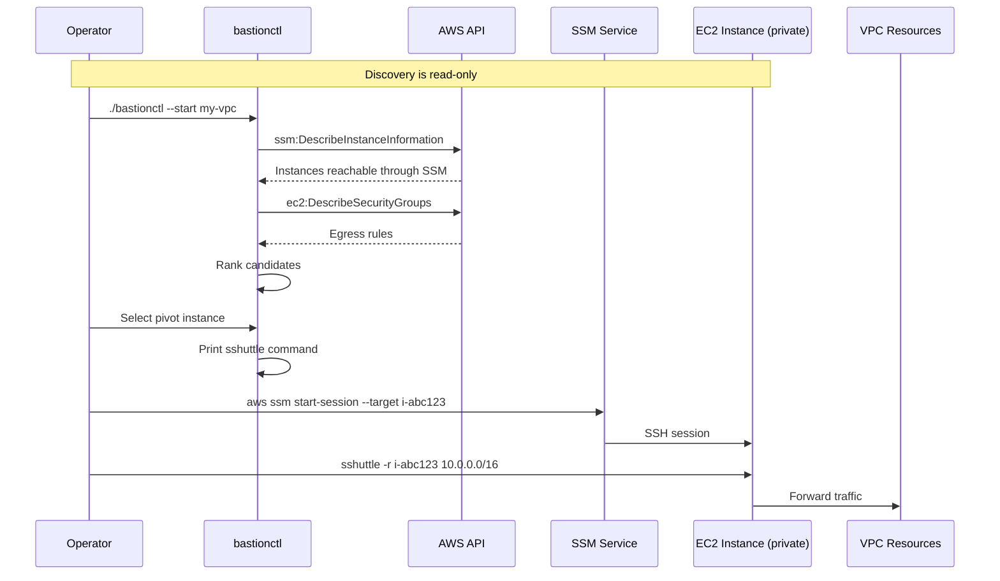
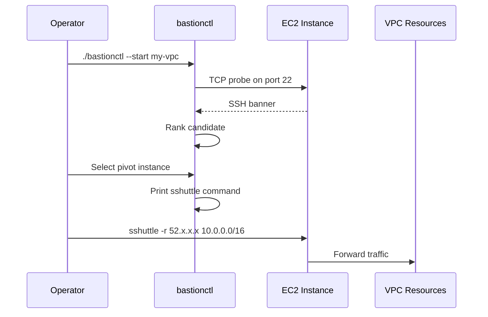

# Connection architecture

## How it works

- bastionctl resolves AWS credentials with STS and lists saved connections per account.
- For a new connection, it discovers VPCs and running instances, then checks reachability through SSM or direct TCP.
- Candidate Security Group egress is checked against VPC CIDRs; restricted egress ranks lower.
- You choose a candidate, verify it with SSH, choose an SSH user and key if needed, then save it as a VPC or dedicated-network connection.
- Later runs recheck the saved target and print, launch, or background the tunnel.

bastionctl hands off tunneling to your system's `sshuttle` binary. It does not
implement the tunnel or store SSH credentials. Run the printed command as your
normal user; `sshuttle` elevates its firewall helper when needed. bastionctl
uses `sudo` only for opt-in split-DNS resolver setup.

## SSM-brokered connection

An SSM-managed instance does not need a public IP or inbound SSH port. The
operator's SSH configuration starts an AWS Session Manager connection, and
`sshuttle` carries traffic through that SSH connection.

The instance needs no public IP or inbound Security Group rule. AWS IAM
authorizes the SSM session, and SSH uses the operator's existing
`~/.ssh/config` and agent. bastionctl's AWS discovery calls are read-only;
the actual tunnel is created by `sshuttle` and SSH.

## Direct TCP connection

For an instance reachable over a public network or VPN, bastionctl probes SSH
and ranks reachable candidates. The chosen SSH target is then used by
`sshuttle`.

