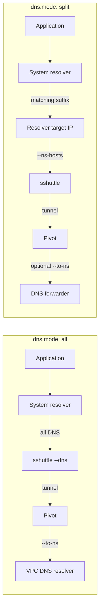

# Split DNS

By default, the tunnel routes selected subnets only. Split DNS also sends
queries for chosen domain suffixes through the VPC, for private Route 53 zones
and internal services.

## How it works

`sshuttle` cannot filter DNS by domain. `--ns-hosts <IP>` captures queries sent
to a resolver IP, while `--dns` captures all DNS traffic handled by the local
system. Split DNS combines the OS resolver and `sshuttle`:

1. The OS sends only configured suffixes to the VPC resolver IP.
2. `sshuttle --ns-hosts` captures queries sent to that IP and tunnels them.

The VPC resolver is detected from the primary IPv4 CIDR using AWS's network
base plus two convention (`10.0.0.0/16` becomes `10.0.0.2`). In `all` mode,
that resolver is the default `--to-ns` target. Set `dns.to_ns` or
`--dns-to-ns` to use another forwarder. This setting does not install or
change the local OS resolver.

## Modes

| `dns.mode` | sshuttle flags | Meaning |
| --- | --- | --- |
| `off` (default) | none | Route selected subnets only. |
| `all` | `--dns --to-ns <IP>` | Send all DNS through the VPC resolver or configured forwarder. |
| `split` | `--ns-hosts <IP>` and optional `--to-ns` | Send only configured domains to the VPC resolver. |



## Configure

DNS settings are saved in each connection's `dns:` block. The `--dns`,
`--dns-domain`, `--dns-resolver`, and `--dns-to-ns` flags persist overrides.
Interactive discovery also offers Off, All, and Split presets.

```bash
# Save settings and print the tunnel and resolver commands
bastionctl corp --dns split --dns-domain corp.internal --dns-resolver 10.0.0.2

# Let bastionctl install resolver configuration (asks for sudo)
bastionctl corp --start --manage-dns

# Install or remove resolver configuration separately
sudo bastionctl --dns-setup corp
bastionctl --dns-teardown corp
```

Resolver changes are opt-in. On macOS, bastionctl writes one tagged
`/etc/resolver/<domain>` file per domain and removes only files it owns. On
Linux with systemd-resolved, it creates a dedicated dummy link and configures
`resolvectl`; it refuses to reuse a link it does not own. Without
systemd-resolved, it reports a dnsmasq alternative.

Installed state is recorded beside the connection file as
`<connection>.dns-state.yaml`. Teardown uses this snapshot, not current YAML.
`--stop`, `--forget`, and `--dns-teardown` remove managed state;
`--status` warns if resolver configuration remains while the tunnel is down.
`--rescan` reconciles installed settings.

## Platform notes and limitations

For private domains on macOS, prefer Split mode when applications use the
system resolver. Some macOS resolver clients may fail with All mode even when
`dig` succeeds; test with the application that needs the name.

Split DNS captures resolver traffic by IP, not protocol. Browsers using DoH or
DoT bypass the OS resolver. Unqualified single-label names may not follow the
split rules. Auto-detection supports IPv4 only; set `--dns-resolver` for IPv6.
Linux split DNS requires `ip` and `resolvectl`; otherwise bastionctl prints a
dnsmasq configuration suggestion.

`--manage-dns` is a one-way setting for the current connection. To stop
automatic management, run `--dns-teardown` and remove `manage_resolver` from
the connection YAML.